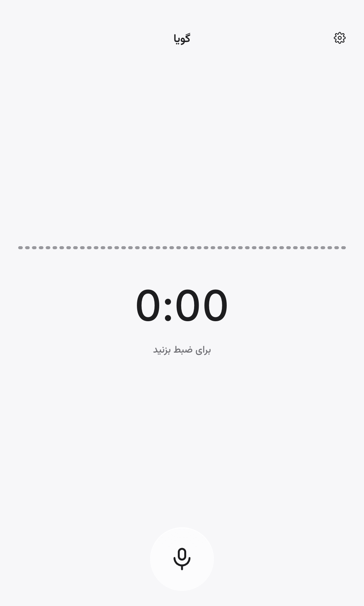
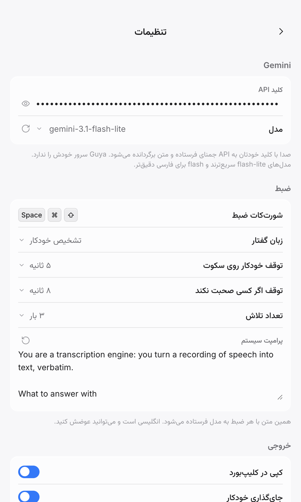

# گویا · Guya

**تبدیل گفتار به متن روی دسکتاپ، با کلید Gemini خودتان.** یک شورتکات می‌زنید، صدا
مستقیم از دستگاه خودتان به API گوگل می‌رود، و متن در کلیپ‌بورد است. برای macOS،
ویندوز و لینوکس.

[](https://github.com/MahdiMirshafiee/Guya/actions/workflows/ci.yml)
[](LICENSE)

[English](README.md) · [فارسی](README.fa.md)

| ضبط | تنظیمات |
| --- | --- |
|  |  |

## چه می‌کند

- **یک کلید، یک کار.** شورتکات را بزنید، حرف بزنید، دوباره بزنید. متن در کلیپ‌بورد
  کپی می‌شود — و اگر بخواهید، در برنامه‌ای که فوکوس دارد هم تایپ می‌شود.
- **اکولایزر واقعی.** فرم موج پنجره و orb شناور هر دو از خودِ میکروفون کشیده می‌شوند:
  چهل‌وهشت باند، بر حسب دسی‌بل نسبت به سطح نویز همان اتاقی که در آن هستید؛ پس نویز
  صفر است و صدای شما آن را تکان می‌دهد.
- **خودش تمام می‌کند.** سه ثانیه بعد از این‌که حرف زدن را قطع کردید، یا هشت ثانیه
  در ضبطی که هنوز کسی حرف نزده — و در حالت دوم هیچ درخواستی به سرور فرستاده نمی‌شود.
- **دو زبان، تا آخر.** رابط فارسی یا انگلیسی است، و جهت متن از خودِ متن می‌آید نه از
  زبان رابط: متن فارسی داخل پنجره‌ی انگلیسی هم راست‌به‌چپ خوانده می‌شود.
- **هیچ‌چیز بین شما و گوگل نیست.** سرور واسطی وجود ندارد؛ کلید با سرویس خود سیستم
  رمزنگاری می‌شود (keychain در مک، DPAPI در ویندوز) و جای دیگری نمی‌رود.
- **میکروفون همیشه باز نیست.** کلمه‌ی فعال‌سازی و گوش‌دادن دائمی وجود ندارد: دستگاه
  با شروع ضبط باز و با تمام شدنش بسته می‌شود.

## نصب

از [ریلیزها](../../releases/latest) فایل مناسب سیستمتان را بگیرید:

| سیستم | فایل | توضیح |
| --- | --- | --- |
| مک (Apple silicon) | `Guya-<version>-macOS-arm64.dmg` | مک‌های سری M |
| مک (Intel) | `Guya-<version>-macOS-x64.dmg` | مک‌های اینتل |
| ویندوز (x64) | `Guya-<version>-Windows-x64-Setup.exe` | نصب‌کننده؛ نسخه‌ی `Portable` نیازی به نصب ندارد |
| ویندوز (arm64) | `Guya-<version>-Windows-arm64-Setup.exe` | ویندوز روی ARM |
| لینوکس (x64) | `Guya-<version>-Linux-x64.AppImage` | پرتابل؛ `chmod +x` و اجرا |
| لینوکس (x64، دبیان) | `Guya-<version>-Linux-x64.deb` | `sudo apt install ./Guya-...deb` |
| لینوکس (arm64) | `Guya-<version>-Linux-arm64.AppImage` | ماشین‌های arm64 |

فایل‌ها **امضای دیجیتال ندارند**، پس بار اول سیستم هشدار می‌دهد:

- **مک** — «Guya cannot be opened because the developer cannot be verified»: روی اپ
  راست‌کلیک کنید و *Open* را بزنید، یا
  `xattr -dr com.apple.quarantine /Applications/Guya.app`.
- **ویندوز** — SmartScreen می‌گوید «Windows protected your PC»: *More info* →
  *Run anyway*.
- **لینوکس** — روی بعضی توزیع‌ها AppImage به `--no-sandbox` نیاز دارد:
  `./Guya-*.AppImage --no-sandbox`.

## اولین اجرا

اگر کلیدی ثبت نشده باشد، صفحه‌ی تنظیمات خودش باز می‌شود.

1. کلید API جمنای را از <https://aistudio.google.com/apikey> بگیرید و بگذارید.
2. **دریافت مدل‌ها** را بزنید و یکی را انتخاب کنید. `gemini-2.5-flash` انتخاب خوبی
   است؛ `flash-lite` سریع‌تر است و `flash` برای فارسی دقیق‌تر.
3. **تست کلید** را بزنید تا قبل از تکیه‌کردن روی آن، مطمئن شوید درست است.

## استفاده

| کار | نتیجه |
| --- | --- |
| شورت‌کات | بزنید = شروع، دوباره بزنید = توقف (`⌘⇧Space` در مک، `Ctrl+Shift+Space` در بقیه) |
| توقف روی سکوت | ۳ ثانیه بعد از آخرین کلمه، ضبط تمام می‌شود و برای تبدیل می‌رود |
| توقف اگر کسی صحبت نکند | ۸ ثانیه سکوت، ضبط را تمام می‌کند و **هیچ درخواستی فرستاده نمی‌شود** |
| کلید Escape | حین ضبط: تمام کردن و فرستادن برای تبدیل. حین انتظار: لغو کردن |

- **انتظار بن‌بست نیست.** تا وقتی برنامه مشغول است Escape گرفته می‌شود و درخواست را
  لغو می‌کند؛ دکمه‌ی وسط برنامه هم در همان حال «انصراف» می‌شود.
- **orb می‌گوید در چه حالی هستید.** تا وقتی میکروفون باز می‌شود آبی است و همان لحظه
  که واقعاً زنده شد گرم می‌شود — بعد از آن حرف بزنید، نه قبلش.
- **همه‌چیز تنظیم است.** دو زمان توقف، تعداد تلاش‌ها، مدل، زبان گفتار، و دستورهایی
  که به مدل فرستاده می‌شود. هر کدام مقداری را که در فهرست نیست، با «دلخواه…» قبول
  می‌کنند.

## حریم خصوصی

- **صدا** با کلید خودتان به API جمنای می‌رود و جای دیگری نمی‌رود. سرور واسط، حساب
  کاربری، تلمتری و آنالیتیکس وجود ندارد.
- **کلید** با سرویس خود سیستم‌عامل رمزنگاری می‌شود (keychain در مک، DPAPI در ویندوز)؛
  سیستمی که چنین سرویسی ندارد آن را در فایل تنظیمات با دسترسی فقط برای مالک نگه
  می‌دارد.
- **تنظیمات** در `~/Library/Application Support/Guya/settings.json` در مک و
  `%APPDATA%\Guya\settings.json` در ویندوز است.
- **میکروفون** فقط در حین ضبط باز است. اپ تا وقتی مک دسترسی Accessibility نداده،
  تایپ در برنامه‌های دیگر را قبول نمی‌کند (به‌جای اینکه بعداً شکست بخورد).

## تنظیمات

| گزینه | کار |
| --- | --- |
| کلید API | کلید Gemini؛ رمزنگاری‌شده روی همین دستگاه |
| مدل | با «دریافت مدل‌ها» از API خوانده می‌شود؛ دستی هم قابل تایپ است |
| زبان گفتار | تشخیص خودکار یا یک زبان مشخص، برای دقت بیشتر |
| توقف روی سکوت | خاموش، یا ۱ تا ۱۲۰ ثانیه (پیش‌فرض ۳) |
| توقف اگر کسی صحبت نکند | خاموش، یا ۱ تا ۱۲۰ ثانیه (پیش‌فرض ۸) |
| تعداد تلاش | چند بار درخواست ناموفق دوباره تلاش شود (پیش‌فرض ۳) |
| پرامپت سیستم | دستورهایی که با هر ضبط به مدل می‌رود؛ قابل ویرایش و بازگرداندن |
| کپی در کلیپ‌بورد | کپی خودکار متن بعد از تبدیل |
| جای‌گذاری خودکار | تایپ در برنامه‌ی فعال (نیاز به دسترسی Accessibility در مک) |
| اجرا هنگام ورود | اجرای خودکار اپ بعد از ورود (فقط نسخه‌ی نصب‌شده) |

## عیب‌یابی

| چه می‌بینید | یعنی چه |
| --- | --- |
| «متنی از صدا تشخیص داده نشد.» | اپ در ضبط، گفتاری اندازه نگرفت — معمولاً دستگاه ورودی بی‌صدا است یا میکروفونی است که فکرش را نمی‌کردید. دستگاه ورودی را در تنظیمات سیستم چک کنید. |
| «کلید API جمنای ثبت نشده است.» | از صفحه‌ی تنظیمات یکی اضافه کنید. |
| «سهمیه پر شده؛ حدود N ثانیه دیگر دوباره تلاش کنید.» | محدودیت نرخ سرویس. اپ همان مدت اعلام‌شده را می‌گوید، به‌جای اینکه بی‌فایده دوباره تلاش کند. |
| «این مدل برای کلید شما در دسترس نیست.» | مدل حذف شده یا برای آن کلید فعال نیست: «دریافت مدل‌ها» را بزنید و یکی دیگر انتخاب کنید. |
| شورت‌کات هیچ کاری نمی‌کند | برنامه‌ی دیگری آن ترکیب را گرفته است. صفحه‌ی تنظیمات این را می‌گوید، شورت‌کات قبلی را نگه می‌دارد و می‌گذارد ترکیب دیگری ثبت کنید. |
| «جای‌گذاری خودکار» کار نمی‌کند | دسترسی Accessibility برای Guya داده نشده. آن گزینه روشن نمی‌ماند و دقیقاً همان صفحه‌ای را که باید باز کنید پیشنهاد می‌دهد. |
| متن خالی است ولی حرف زدم | ضبط آنقدر آرام بوده که مدل چیزی نشنیده. «توقف روی سکوت» و سطح ورودی در صفحه‌ی ضبط را چک کنید. |

## ساخت از سورس

Node نسخه‌ی ۲۲ یا بالاتر (هارنس انتها‌به‌انتها از `WebSocket` سراسری استفاده می‌کند).

```bash
npm ci          # درخت دقیق وابستگی‌ها
npm start       # اجرا
npm test        # تست‌های واحد + گیت ساختار
npm run e2e     # اپ را با میکروفون جعلی اجرا و رابط را می‌سنجد
```

بسته‌بندی، برای هر پلتفرم:

```bash
npm run dist:this    # همان سیستمی که رویش هستید
npm run dist:mac     # dmg + zip، برای arm64 و x64
npm run dist:win     # نصب‌کننده‌ی nsis + پرتابل، برای x64 و arm64
npm run dist:linux   # AppImage + deb، برای x64 و arm64
```

خروجی‌ها در `dist/` می‌افتند و در گیت نیستند. هر پلتفرم روی سیستم خودش بهترین نتیجه
را می‌دهد — همان کاری که CI می‌کند — چون `deb` به `dpkg` نیاز دارد و AppImage به
`appimagetool`، و ورک‌فلوها هر دو را خودشان نصب می‌کنند.

## ساختار

```
src/main/       فرایند اصلی: پنجره‌ها، شورت‌کات سراسری، ارتباط با سرویس، کلیپ‌بورد،
                پروتکل app:// که رندررها را سرو می‌کند
src/preload/    پل بین رندرر و فرایند اصلی
src/renderer/   پنل (ضبط + تنظیمات) و overlay شناور
src/shared/     کد مشترک دو فرایند: صدا، دیکشنری دوزبانه، پرامپت، شورت‌کات، جهت متن
scripts/        تولید آیکون، اسکریپت ریلیز، گیت ساختار
```

فرایند اصلی به تفکیک مسئولیت تقسیم شده — `index.js` سیم‌کشی می‌کند، `recorder.js`
مالک یک نشست ضبط است، `state.js` مالک فاز، `gemini.js` با API حرف می‌زند،
`system.js` از سیستم‌عامل چیز می‌خواهد — و `scripts/check-structure.js` بیلد را روی
هر حلقه‌ی require، هر importی که چیزی را نام می‌برد که ماژول export نکرده، هر
فراخوانی به نامی که در فایل تعریف نشده، و هر ماژول `src/shared/` که به Electron دست
بزند، متوقف می‌کند.

دو سند قواعد را نگه می‌دارند: [`DESIGN.md`](DESIGN.md) قرارداد رابط است (توکن‌ها،
کامپوننت‌ها، و لاگ تصمیم‌هایی که می‌گوید چه چیزی رد شد و چرا) و
[`AGENTS.md`](AGENTS.md) توافق کاری هر کسی است که کد را عوض می‌کند — از جمله
قواعد غیرقابل‌مذاکره‌ای که تست‌ها تضمین می‌کنند، مثل نبودن هیچ متن کاربری بیرون از
دیکشنری و باز نبودن میکروفون بیرون از ضبط.

## فونت‌ها و آیکون‌ها

- [Vazirmatn](https://github.com/rastikerdar/vazirmatn) برای فارسی و
  [Inter](https://github.com/rsms/inter) برای لاتین، هر دو با پروانه‌ی SIL OFL 1.1،
  همراه خودشان در `src/renderer/assets/fonts/` — هیچ‌چیز در زمان اجرا از اینترنت
  گرفته نمی‌شود.
- آیکون‌ها از [Lucide](https://lucide.dev) (MIT)، به‌صورت inline.
- آیکون خود اپ همان orb است: کره‌ای نورپردازی‌شده روی تایلی که شبکه‌ی آیکون اپل را
  دنبال می‌کند، ساخته‌شده با `scripts/make-icons.js`.

## مجوز

MIT — © Mahdi Mirshafiee. متن کامل در [`LICENSE`](LICENSE).
