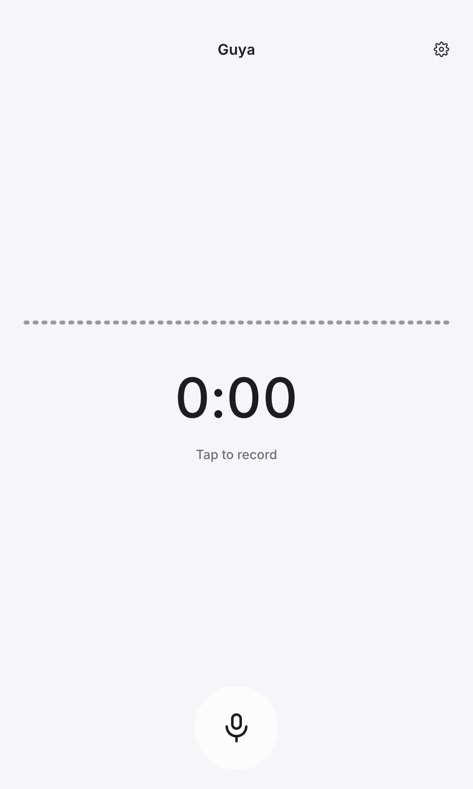
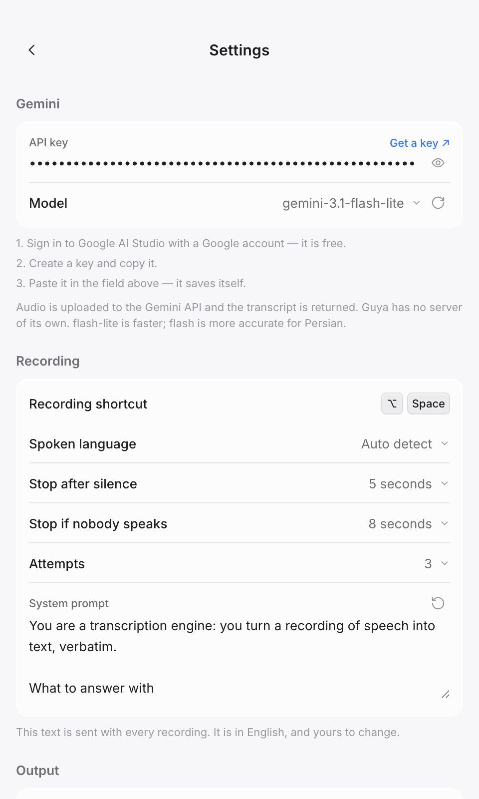

# Guya · گویا

**Voice to text on your desktop, with your own Gemini key.** One shortcut records,
the audio goes straight from your machine to Google's API, and the transcript is on
your clipboard. macOS, Windows and Linux.

[](https://github.com/MahdiMirshafiee/Guya/actions/workflows/ci.yml)
[](LICENSE)

[English](README.md) · [فارسی](README.fa.md)

| Recording | Settings |
| --- | --- |
|  |  |

## What it does

- **One key, one job.** Press the shortcut, speak, press it again. The transcript is
  copied to the clipboard — and typed into whatever app has focus, if you ask for that.
- **A real equalizer.** The window's meter and the floating orb are both drawn from
  the microphone: forty-eight bands, measured in decibels against the noise floor of
  the room you are actually in, so noise reads as nothing and your voice moves it.
- **It stops on its own.** Three seconds after you stop speaking, or eight seconds
  into a recording where nobody has spoken — and in that second case nothing is sent
  to the provider at all.
- **Two languages, end to end.** The interface is Persian or English, and a transcript
  is laid out by its own language, not the interface's: Persian reads right-to-left
  inside an English window.
- **Nothing between you and Google.** There is no server of the app's own; the key is
  stored encrypted with the system keychain (or DPAPI on Windows) and goes nowhere else.
- **No standing microphone.** There is no wake word and no always-on listening: the
  device opens when a recording starts and closes the moment it stops.

## Install

Download the file for your system from [Releases](../../releases/latest):

| System | File | Notes |
| --- | --- | --- |
| macOS (Apple silicon) | `Guya-<version>-macOS-arm64.dmg` | M-series Macs |
| macOS (Intel) | `Guya-<version>-macOS-x64.dmg` | Intel Macs |
| Windows (x64) | `Guya-<version>-Windows-x64-Setup.exe` | Installer |
| Windows (arm64) | `Guya-<version>-Windows-arm64-Setup.exe` | Installer |
| Windows, without installing | `Guya-<version>-Windows-x64-Portable.exe` | Also `-arm64-Portable`; unpacks itself into a temporary folder on every launch, so it starts more slowly than the installer |
| Linux (x64) | `Guya-<version>-Linux-x86_64.AppImage` | Portable; `chmod +x` and run |
| Linux (x64, Debian) | `Guya-<version>-Linux-amd64.deb` | `sudo apt install ./Guya-...deb` |
| Linux (arm64) | `Guya-<version>-Linux-arm64.AppImage` | Portable; also `-arm64.deb` |

Every system ships both of its architectures, and the file name says which is which —
`arm64` for Apple silicon and ARM machines, `x64` (or Linux's own `x86_64` and `amd64`)
for Intel and AMD. On Windows an ARM machine can run the x64 build too.

The builds are **not code-signed**, so the system will warn the first time:

- **macOS** — "Guya cannot be opened because the developer cannot be verified".
  On macOS 15 and later there is no *Open* in the Control-click menu for an
  unnotarised app; do this instead, once:
  `xattr -dr com.apple.quarantine /Applications/Guya.app`, or allow it in
  System Settings → Privacy & Security → *Open Anyway*.
- **Windows** — SmartScreen says "Windows protected your PC": *More info* → *Run anyway*.
- **Linux** — the AppImage needs `--no-sandbox` on some distributions if Chrome's
  sandbox cannot be used: `./Guya-*.AppImage --no-sandbox`.

## First run

The window opens when the app starts, and with no key yet the recorder says *No Gemini API
key yet.* — the settings screen behind the gear is where the key goes. Its field carries
*Get a key* on its own line, which opens <https://aistudio.google.com/apikey>, and the three
steps are written under the group.

1. Paste a Gemini API key from <https://aistudio.google.com/apikey>.
2. Press **Refresh models** and pick one. `flash-lite` is faster, `flash` is more
   accurate for Persian.
3. Press **Test key** to check it before you rely on it.

## Using it

| Action | Result |
| --- | --- |
| The shortcut | Press to start, press again to stop (`⌘⇧Space` on macOS, `Ctrl+Shift+Space` elsewhere) |
| Stop after silence | 3 seconds after your last word the recording ends and is transcribed |
| Stop if nobody speaks | 8 seconds of nothing ends the recording with **no request sent** |
| Escape | While recording: stop and transcribe. While waiting: cancel |

- **Waiting is not a dead end.** Escape is held while the app is busy and cancels the
  request, and the record button becomes a *Cancel* control while the answer is coming.
  (On Linux/Wayland no app can grab Escape; there the shortcut ends the recording, and so
  does the silence timer.)
- **The orb tells you which state you are in.** It is blue while the microphone is
  opening and turns warm the moment it is actually live — speak after that, not before.
- **Everything is a setting.** Both waits, the model and the instructions sent to the
  model are yours to change, and each wait takes a value the picker does not list through
  *Custom…*. The attempts per transcription and the spoken language are short closed lists.
- **A recording nobody spoke into is not a question.** The app says "no speech detected"
  and sends nothing — and if a reply ever comes back as a sentence *about* the request
  instead of the transcript, it is discarded rather than typed into your window.

### Quitting

Closing the window hides it: the shortcut keeps working, which is the point of a
background utility. To stop the app completely, open the window again and use **Quit
Guya** at the bottom of the settings screen — on macOS, `⌘Q` from the menu does it. On
Windows and Linux the setting is the only control that quits, because those systems give
the app no menu bar.

## Privacy

- **Audio** is sent to the Gemini API with your key, and nowhere else. There is no
  server in the middle, no account, no telemetry, no analytics.
- **The key** is written encrypted using the operating system's own service (the
  keychain on macOS, DPAPI on Windows); a system without one keeps it in the settings
  file, with permissions set to the owner.
- **Settings** live in `~/Library/Application Support/Guya/settings.json` on macOS,
  `%APPDATA%\Guya\settings.json` on Windows, and `~/.config/Guya/settings.json` on Linux.
- **The microphone** is open only while recording. The app refuses to type into other
  apps until the system has granted Accessibility, rather than failing later.

## Settings

| Setting | What it does |
| --- | --- |
| API key | Your Gemini key, stored encrypted on this machine. *Get a key* on the field's own line opens Google AI Studio, and the three steps are written under the group |
| Model | The four this app is built against, or the whole list from *Refresh models*; can also be typed |
| Spoken language | Auto-detect, or one language for more accuracy |
| Stop after silence | Off, or 1–120 seconds (3 by default) |
| Stop if nobody speaks | Off, or 1–120 seconds (8 by default) |
| Attempts | Tries per transcription, the first one included (3 by default) |
| System prompt | The instructions sent with every recording; editable, and resettable |
| Copy to clipboard | Copy the transcript when it arrives |
| Paste automatically | Type it into the focused app. macOS needs Accessibility; Windows uses the system's own scripting; on Linux it needs `xdotool` (X11) or `ydotool`/`wtype` (Wayland) installed |
| Launch at login | Start the app when you sign in — macOS and Windows, in an installed build. Linux has no login item an app may set: there the desktop owns its own startup list |
| Quit Guya | Stops the app; shown where there is no menu bar, since closing the window only hides it |

## Troubleshooting

| What you see | What it means |
| --- | --- |
| "No speech detected in that audio." | The app measured no speech in the recording — usually a muted input device or a microphone that is not the one you think. Check the input device in your system settings. |
| "No Gemini API key yet." | Add one in the settings screen. |
| "Quota reached. Try again in about N seconds." | The provider's rate limit. The app tells you the wait it was given instead of retrying into it. |
| "This model is not available for your key." | The model was removed or is not enabled for that key: press *Refresh models* and pick another. |
| The shortcut stopped working mid-recording | Another app took the combination; the app checks the key while it is recording and takes it again by itself. |
| The shortcut does nothing | Another app already owns that combination. The recorder says the app is not holding it, the settings row says the same, and choosing another one takes one press — while you are choosing, the app hands the keys back so the field can hear them. |
| Paste automatically does nothing on Windows | Windows blocks typing into windows that run as administrator. Run Guya as administrator as well, or paste by hand (the transcript is already on the clipboard). |
| Paste automatically does nothing | macOS has two permissions for this and the app offers the pane it actually needs: **Accessibility** to send keystrokes, and — the first time — **Automation**, to let Guya drive System Events. If the transcript is on screen in Guya's own window, nothing is typed: there is nowhere sensible to type it. |
| Nothing is typed, on Linux | No automatic-paste helper is installed — `xdotool` on X11, or `ydotool` or `wtype` on Wayland. The settings row says so, and the transcript is on the clipboard either way. |
| The orb is a black box, or not at the top (Linux) | The orb needs a compositor that supports transparent windows, and on Wayland the desktop may ignore the position the app asks for. The transcript and the recording itself are not affected. |
| The transcript is empty but I spoke | The recording was quiet enough that the model heard nothing. *Stop after silence* and the input level in the recorder are the things to check. |

## Building from source

Node 22 or newer (the end-to-end harness uses the global `WebSocket`).

```bash
npm ci          # exact dependency tree
npm start       # run it
npm test        # unit tests + the structure gate
npm run e2e     # launches the app with a fake microphone and drives the interface
```

Packaging, per platform:

```bash
npm run dist:this    # the system you are on
npm run dist:mac     # dmg, arm64 and x64
npm run dist:win     # nsis installer + portable, x64 and arm64
npm run dist:linux   # AppImage + deb, x64 and arm64
```

Artifacts land in `dist/` and are not committed. Each platform packages on its own
system — that is what CI does — and `electron-builder` fetches the tooling it needs for
a `.deb` or an AppImage itself, so the runners start with nothing installed.

## How it is built

```
src/main/       the main process: windows, the global shortcut, the provider, the
                clipboard, the app:// protocol that serves the renderers
src/preload/    the bridge between the renderers and the main process
src/renderer/   the panel (recorder + settings) and the floating overlay
src/shared/     code both processes use: audio, the dictionary, the prompt,
                the shortcut parser, the bidi rules
scripts/        the icon generator, the release script and its publish step, the
                release notes, the local installer, the structure gate
```

The main process is split by responsibility — `index.js` wires, `recorder.js` owns a
session, `state.js` owns the phase, `gemini.js` talks to the API, `system.js` asks the
OS for things — and `scripts/check-structure.js` fails the build on a require cycle, an
import that names something a module does not export, a call to a name a module never
defines, or a shared module that reaches for Electron.

Two documents carry the rules: [`DESIGN.md`](DESIGN.md) is the interface contract
(tokens, components, and a decision log that records what was rejected and why), and
[`AGENTS.md`](AGENTS.md) is the working agreement for anyone changing the code —
including the non-negotiables the test suite enforces, such as no user-visible string
outside the dictionary and no microphone outside a recording.

## Fonts and icons

- [Vazirmatn](https://github.com/rastikerdar/vazirmatn) for Persian and
  [Inter](https://github.com/rsms/inter) for Latin, both SIL OFL 1.1, bundled locally
  with their license files in `src/renderer/assets/fonts/` — nothing is fetched at
  runtime.
- Icons from [Lucide](https://lucide.dev) (MIT), drawn inline.
- The app icon is the orb itself: a lit sphere on a tile that follows Apple's icon
  grid, generated by `scripts/make-icons.js`.

## License

MIT — © Mahdi Mirshafiee. See [`LICENSE`](LICENSE).
